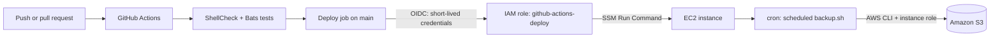
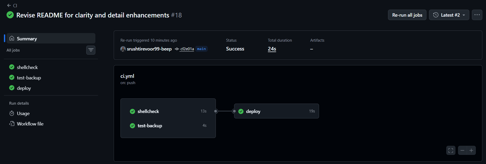

# CloudOps Toolkit

Automated Linux operations and AWS backups using **Bash, Amazon S3, EC2, and GitHub Actions**.

[](https://github.com/srushtirevoor99-beep/cloudops-toolkit/actions/workflows/ci.yml)


## Overview

CloudOps Toolkit is a collection of Bash scripts for Linux administration and cloud operations. Its primary workflow creates timestamped, compressed backups, optionally uploads them to Amazon S3, and schedules them to run on an EC2 instance.

The project also demonstrates automated testing, static analysis, and deployment through GitHub Actions. Deployment uses GitHub's OpenID Connect (OIDC) integration and AWS Systems Manager (SSM), avoiding long-lived AWS access keys in the repository.

## Features

- **Timestamped backups:** Create compressed `.tar.gz` archives.
- **Optional S3 uploads:** Set `BUCKET_NAME` to upload backups; without it, backups remain local.
- **Failure handling:** Validate the source directory, check archive creation, and stop on failures to avoid uploading an invalid or empty archive.
- **Local retention:** Keep the five most recent local backups by default; configure the count with `KEEP`.
- **Encrypted uploads:** Use S3 server-side encryption with `AES256`.
- **Restore verification:** Download a selected backup, verify that the archive is readable, and extract only after verification.
- **Optional SNS alerts:** Set `NOTIFY_TOPIC_ARN` to publish a notification when a backup fails.
- **Keyless CI/CD authentication:** GitHub Actions uses short-lived OIDC credentials; EC2 uses its attached IAM role.
- **Automated checks:** Run ShellCheck and a Bats test suite on pushes and pull requests.
- **Automated deployment:** After the required checks pass on `main`, GitHub Actions deploys updates to EC2 through SSM.

## Architecture



A push or pull request triggers automated checks. When changes reach `main` and the required checks pass, the deployment job uses OIDC to obtain temporary AWS credentials and SSM to update the EC2 instance. A cron job on the instance runs the backup script on its configured schedule.

## Technology Stack

| Technology | Purpose |
|---|---|
| Bash | Backup automation and Linux utility scripts |
| Ubuntu on WSL2 / Amazon Linux 2023 | Development and EC2 environments |
| Amazon EC2 | Runs scheduled operations |
| Amazon S3 | Off-instance backup storage |
| AWS IAM | Controls permissions for EC2 and GitHub Actions |
| AWS Systems Manager | Remote command execution and deployment without SSH-based deployment |
| GitHub Actions + OIDC | CI/CD with short-lived AWS credentials |
| ShellCheck | Static analysis for shell scripts |
| Bats | Automated shell-script tests |
| cron | Scheduled backups and monitoring checks |
| Git and GitHub | Version control, branches, and pull requests |

## AWS Environment

The project README currently documents the following setup. Update these details if your deployed resources change.

| Resource | Documented configuration |
|---|---|
| Region | Asia Pacific (Mumbai), `ap-south-1` |
| EC2 instance | `cloudops-backup-server`, `t3.micro`, Amazon Linux 2023 |
| Instance access | Systems Manager Session Manager and EC2 Instance Connect |
| S3 bucket | `srushti-cloudops-backups-4821`, with backups under `backups/` |
| EC2 instance role | `cloudops-ec2-s3-role` |
| GitHub Actions deployment role | `github-actions-deploy` |
| Deployment policy | `github-deploy-ssm`, scoped to the intended instance |

## CI/CD Pipeline

Workflow file: [`.github/workflows/ci.yml`](.github/workflows/ci.yml)



| Job | Responsibility |
|---|---|
| `shellcheck` | Lints scripts in `scripts/` and test stubs in `tests/stubs/`. |
| `test` | Runs the Bats suite. Fake AWS commands let tests exercise S3, restore, and SNS paths without using live AWS credentials. |
| `deploy` | Runs on `main` after the required checks pass. It authenticates with OIDC and uses SSM Run Command to update the EC2 instance. |

### How Keyless Deployment Works

| Component | Configuration |
|---|---|
| OIDC provider | `token.actions.githubusercontent.com` |
| IAM trust policy | Intended to allow this repository's `main` branch to assume `github-actions-deploy` |
| IAM permissions | SSM command execution for the intended instance, plus permission to check command status |
| GitHub repository variables | `AWS_ROLE_ARN` and `EC2_INSTANCE_ID`; no long-lived AWS access keys are required for this workflow |

> **Deployment prerequisite:** The EC2 instance must be running and show as **Online** in Systems Manager. Otherwise, the deployment may fail with `InvalidInstanceId`.

## Getting Started

### Prerequisites

- Linux or WSL2 with Bash 4.4 or newer and GNU utilities.
- Git.
- AWS CLI v2, if you plan to upload to S3 or inspect S3 backups.
- An AWS account and an S3 bucket for cloud backup workflows.
- Appropriate AWS permissions for the operations you run.

### Clone the Repository

```bash
git clone https://github.com/srushtirevoor99-beep/cloudops-toolkit.git
cd cloudops-toolkit
chmod +x scripts/*.sh
```

### Create a Local Backup

The backup script accepts a source directory and a destination directory:

```bash
./scripts/backup.sh <source_dir> <dest_dir>
```

Example:

```bash
mkdir -p ~/testdata
echo "CloudOps backup test" > ~/testdata/example.txt
./scripts/backup.sh ~/testdata ~/testbackups
```

### Upload a Backup to S3

Set the bucket name before running the backup:

```bash
export BUCKET_NAME=your-bucket-name
./scripts/backup.sh ~/testdata ~/testbackups
aws s3 ls "s3://$BUCKET_NAME/backups/"
```

On EC2, the AWS CLI should obtain temporary credentials from the instance role. On a development machine, use an appropriately scoped identity; do not use root-account access keys or commit credentials to the repository.

### Restore a Backup

Set `BUCKET_NAME`, then specify the destination directory. To restore a specific archive, provide its filename:

```bash
export BUCKET_NAME=your-bucket-name

# Restore the newest available backup
./scripts/restore.sh ~/restored

# Restore a specific backup
./scripts/restore.sh ~/restored backup-2026-10-24.tar.gz
```

The script is documented to accept filenames matching `backup-YYYY-MM-DD.tar.gz`, download the archive to a temporary directory, check it with `tar -tzf`, and extract only after the readability check passes.

### Configure Failure Notifications

Set the SNS topic ARN if you have created and configured a topic:

```bash
export NOTIFY_TOPIC_ARN=arn:aws:sns:ap-south-1:<account-id>:cloudops-backup-alerts
```

The documented failure paths include a missing source directory, a `tar` failure, or an upload failure. The EC2 role needs permission to publish to the configured topic. See [`docs/iam/`](docs/iam/).

### Schedule Backups with cron

Example cron entry for an EC2 user named `ec2-user`:

```cron
0 2 * * * BUCKET_NAME=<your-bucket> /home/ec2-user/cloudops-toolkit/scripts/backup.sh <source_dir> /home/ec2-user/local-backup >> /home/ec2-user/backup.log 2>&1
```

The README's documented server clock is UTC, so `02:00 UTC` corresponds to `07:30 IST`.

Example monitoring entries that log threshold violations:

```cron
*/15 * * * * /home/ec2-user/cloudops-toolkit/scripts/disk-alert.sh 80 / || logger -t disk-alert "disk usage above 80%"
*/15 * * * * /home/ec2-user/cloudops-toolkit/scripts/memory-alert.sh 80 || logger -t memory-alert "memory usage above 80%"
```

Confirm the paths and script behavior on your instance before installing cron entries.

### Run the Automated Checks

On Ubuntu or WSL2, install the tools if needed:

```bash
sudo apt-get update
sudo apt-get install -y bats shellcheck
```

Then run:

```bash
shellcheck scripts/*.sh tests/stubs/*
bats tests/
```

### Verify a Backup Archive

Download a backup and inspect its contents:

```bash
aws s3 cp s3://<your-bucket>/backups/backup-YYYY-MM-DD.tar.gz /tmp/backup-test.tar.gz
tar -tzf /tmp/backup-test.tar.gz
```

## Repository Structure

```text
cloudops-toolkit/
├── .github/
│   └── workflows/
│       └── ci.yml
├── scripts/
│   ├── backup.sh
│   ├── restore.sh
│   ├── disk-alert.sh
│   ├── log-analyzer.sh
│   ├── log-cleaner.sh
│   ├── memory-alert.sh
│   └── sysinfo.sh
├── tests/
│   ├── stubs/             # Fake commands used by tests
│   ├── test_helper.bash
│   ├── backup.bats
│   ├── restore.bats
│   ├── monitoring.bats
│   └── logs.bats
├── docs/
│   ├── iam/
│   ├── s3-lifecycle.json
│   └── screenshots/
├── CONTRIBUTING.md
├── LICENSE
├── .gitignore
└── README.md
```

## Script Reference

| Script | Usage | Purpose |
|---|---|---|
| `backup.sh` | `backup.sh <src> <dest>` | Creates a timestamped compressed archive, applies local retention, and optionally uploads to S3 and sends an SNS failure alert. |
| `restore.sh` | `restore.sh <dest> [file]` | Downloads a backup from S3, verifies archive readability, and extracts it. |
| `disk-alert.sh` | `disk-alert.sh [threshold] [mount]` | Reports disk usage and exits non-zero when usage exceeds the threshold (default: 80%). |
| `memory-alert.sh` | `memory-alert.sh [threshold]` | Reports memory usage and exits non-zero when memory usage exceeds the threshold (default: 80%). |
| `log-analyzer.sh` | `log-analyzer.sh <file> [top_n] [pattern]` | Lists frequent log lines, optionally filtered by a regular expression. |
| `log-cleaner.sh` | `log-cleaner.sh <dir> <days> [--dry-run]` | Compresses `.log` files older than the specified number of days; `--dry-run` lists candidates without changing them. |
| `sysinfo.sh` | `sysinfo.sh` | Prints a system information summary. |

Scripts are intended to validate arguments and return non-zero status codes for invalid input or failed operations. Check each script's usage output and tests for exact behavior.

## Testing and Verification

The project documentation records the following checks. Treat these as project-reported results and keep them current as the infrastructure or workflow changes.

| Check | Documented result |
|---|---|
| Local backup from a test folder on WSL2 | A `.tar.gz` archive was created |
| S3 upload | The archive appeared in the bucket listing |
| Archive download and inspection on EC2 | The archive was readable and contained test data |
| `aws sts get-caller-identity` on EC2 | Returned the assumed instance role |
| Missing source directory | The script exited with an error and did not upload an archive |
| Cron test | A short-interval test was followed by a daily schedule; logs showed backup/upload messages |
| CI test job | The Bats suite covers backup, restore, alerts, log tools, and failure scenarios |
| CI deployment job | The documented workflow deploys updates to EC2 through SSM |

The latest local test run reported **42 passing Bats tests**, and the pull request screenshot showed **3 of 3 checks passing**. Re-check GitHub Actions for the latest result before relying on that status.

## Security Considerations

- Use an EC2 instance role rather than stored access keys on the server.
- Use GitHub OIDC for short-lived deployment credentials.
- Restrict the deployment role to the intended repository branch, SSM operations, and target instance.
- Keep the S3 bucket's Block Public Access settings enabled unless there is a deliberate, reviewed reason to change them.
- Never commit credentials, private keys, or tokens.
- Use least-privilege IAM policies and review permissions before removing existing access policies.

### Known Limitations

- The project documentation states that the EC2 role still uses `AmazonS3FullAccess`. A narrower policy is available at [`docs/iam/ec2-s3-backup-policy.json`](docs/iam/ec2-s3-backup-policy.json), but it must be applied and tested before removing the broader policy.
- The scheduled job currently backs up a demo directory; it is not a production backup policy.
- S3 lifecycle expiration and SNS notifications require the corresponding AWS resources and configuration to be applied. See the roadmap below.

## Operations and Cost

- Stop the EC2 instance when it is not needed to reduce compute charges. Scheduled backups and deployments will not run as expected while the instance is stopped.
- Before pushing changes to `main`, confirm the instance is running and **Online** in Systems Manager if the deployment workflow targets it.
- Review S3 storage and request costs; remove test backups when they are no longer needed.
- Keep an AWS Budget alert enabled and review the cost impact before approving infrastructure changes.

## Challenges and Lessons Learned

- **Preventing empty archives:** A failed `tar` command had previously allowed an empty archive to be uploaded. The fix validates the source, checks the command's exit status, removes partial archives, and tests the failure path.
- **Using feature branches and pull requests:** Changes are developed and reviewed through branches rather than being committed directly to `main`.
- **Diagnosing `InvalidInstanceId`:** Systems Manager must be able to target the EC2 instance; checking its managed-node status helps diagnose deployment failures.
- **Fixing executable permissions:** Newly added scripts may need `chmod +x` before they can be run directly.
- **Avoiding long-lived credentials:** Instance roles and GitHub OIDC provide temporary credentials without storing AWS access keys in the repository.


## Author

**Srushti Revoor**
Information Science Engineering student | Aspiring Cloud / CloudOps Engineer

- [GitHub profile](https://github.com/srushtirevoor99-beep)
- [CloudOps Toolkit repository](https://github.com/srushtirevoor99-beep/cloudops-toolkit)
